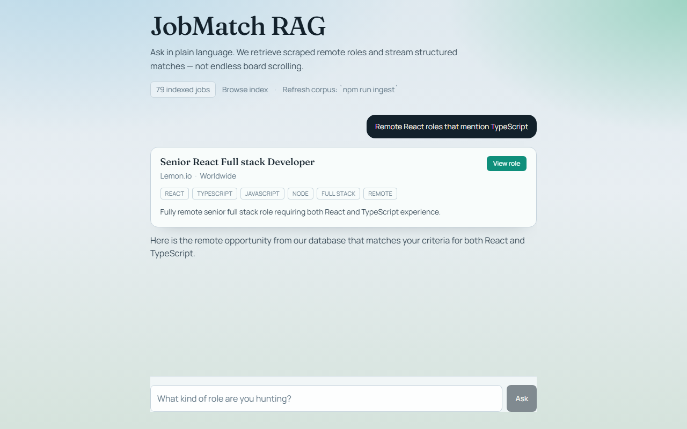
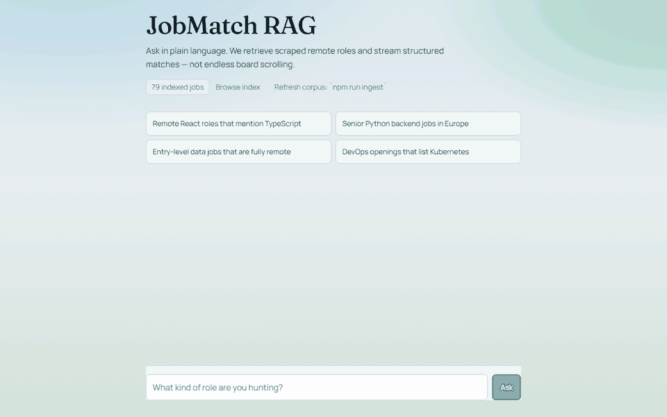

<div align="center">

# JobMatch RAG

### A job search that is allowed to return fewer results.

Natural-language search over scraped remote listings. A metadata prefilter
narrows the field, vector ranking orders what's left, and matches stream back as
structured cards rather than a paragraph about them.

**[→ Live demo](https://job-rag-drab.vercel.app)**

[](https://github.com/JamesKevinJones/job-rag/actions/workflows/ci.yml)
[](LICENSE)


</div>



<sub>A real query against a production build, 21 Oct 2026: `gemini-flash-latest` over
the index refreshed that day. Four listings in the index mention both React and
TypeScript; the model showed one. Fewer, not padded, is the point.</sub>

---

## What it refuses to do

**It won't keep a stale listing.** Every job carries a `lastSeen` stamp, and
`npm run ingest` prunes anything not seen in the last 48 hours:

```ts
export const STALE_MS = 48 * 60 * 60 * 1000;
```

A job board that returns filled roles is worse than no job board, so the index
is allowed to shrink. Recall is not the goal; not wasting an application is.

**What that does and does not guarantee.** Pruning happens at ingest, not at
query time. The live site serves whatever `data/jobs-index.json` was last
committed, so freshness is only as good as the last ingest. The current index was
refreshed on **21 Oct 2026**: 79 listings, all seen that day. The one before it
was from 2 Aug, which is exactly the failure this section exists to prevent, and
it is in "What broke" below.

## Two decisions worth explaining

**No vector database.** The index is a plain JSON file — whole-job embedding
documents, one per listing — committed to the repo and read at request time.
A managed vector store for a few thousand rows is an operational dependency, a
bill, and a cold-start penalty bought to avoid a linear scan that finishes in
milliseconds. It also means the whole thing deploys to Vercel with no
provisioning.

**Filter first, then rank.** The similarity pass only ever sees rows that
already satisfy the hard constraints in the question. "Remote Python roles"
resolves the two structured parts structurally and spends the vector budget on
the rest. If the filters match nothing, retrieval widens to the whole index and
tells the model it did, instead of answering from nothing.

## How retrieval works

```
query → extractFilters()  tags · sources · location · remote-only
      → matchesFilters()  metadata prefilter over the index
      → cosineSimilarity() over embeddings (keywordScore() if the index has none)
      → show_jobs tool call → streamed JobCard components
```

Results come back through Vercel AI SDK tool calling, so the model returns
`show_jobs` with real records and the UI renders `JobCard`s. The listings on
screen are rows from the index, not text the model produced.



## The index, measured

No eval harness yet, so these are facts about the data, not quality claims.
[`docs/EVAL_PLAN.md`](docs/EVAL_PLAN.md) lists the three numbers to measure next.

| | |
|---|---|
| Listings | 79: WWR 40, RemoteOK 29, Remotive 10 |
| Embeddings | all 79, `gemini-embedding-001`, 3072 dimensions |
| Refreshed | 21 Oct 2026, commit `51e5a60`, 57 stale rows pruned |
| Ingest run | 56 s end to end, free Gemini tier, $0 |
| Embedding documents | median 457 characters, longest 9,853 |

## Quickstart

```bash
git clone https://github.com/JamesKevinJones/job-rag.git && cd job-rag
npm install
cp .env.local.example .env.local   # then put your Gemini key in it
npm run dev
```

The committed index is ready to use, so there is nothing to seed. Without a key,
`/jobs` still lists the index, but chat returns an error saying the key is not
configured: Gemini writes the answer, and with an embedded index it also
embeds the query.

Refresh the index (scrape, embed, prune) with your key in `.env.local`:

```bash
npm run ingest
```

`npm run seed` scrapes without embedding. It overwrites the committed index with
one that ranks by keywords only, so use it only to experiment without a key.

## Tests and CI

```bash
npm test
```

22 tests (vitest) on the logic a wrong answer would come from: filter
extraction and matching, cosine ranking versus the keyword fallback, widening
when filters match nothing, pruning exactly what is older than 48 hours, upserts
refreshing `lastSeen`, a missing or corrupt index, the scraper keeping one row
per posting, and embedding batches small enough for the free tier. Gemini and
the network are mocked, so the suite needs no key and spends nothing. CI runs
lint, typecheck, tests and a production build on every push to `main` and every
PR.

## What broke, and what I learned

The README promised a 48-hour index while the live site served one from 2 Aug,
80 days old, because pruning only runs when someone runs the ingest. And that
index had **no embeddings at all**: on a free Gemini key, `npm run ingest` sent
32 job documents per request, up to about 32k tokens, and the free tier
answered every attempt with 429 "quota exceeded" (one small request with the
same key went through). So the index was built with `seed`, and the
live site ranked by keywords while this page described vector search. Batches
of 8, with backoff long enough to outlast a one-minute window, fixed it; the
first full ingest took 56 seconds. Earlier, the model put Markdown into 1 of 8
answers in a UI that renders plain text; the prompt now asks for prose, and
`toPlainText` strips what slips through. The lesson in all three: a property the
README promises needs something that checks it on a schedule, not a sentence.

## Limitations

- **Freshness is manual.** Nothing re-ingests on a schedule yet, so the index
  ages from its refresh date.
- **Free-tier quota is shared.** The live demo and local runs draw on the same
  Gemini limits (20 chat requests a day per model on the free tier). When they
  run out, chat answers with a generic error until the daily reset.
- **Small and source-limited.** About 80 listings from three boards per ingest.
- **No quality numbers yet.** See the eval plan.
- **The `/jobs` page** lets long tag lists push the `lastSeen` column off the
  right edge.

## Sources

RemoteOK and Remotive public APIs, plus a Cheerio HTML path for boards without
one. Sites whose terms forbid automated access are not scraped.

## Structure

| Path | Role |
| --- | --- |
| `src/lib/scraper/` | RemoteOK, Remotive, Cheerio HTML |
| `src/lib/rag/chunk.ts` | Whole-job embedding documents |
| `src/lib/rag/embeddings.ts` | Gemini embeddings, free-tier-sized batches |
| `src/lib/rag/store.ts` | JSON index upsert, `lastSeen` prune |
| `src/lib/rag/retrieve.ts` | Filter extraction, hybrid retrieve |
| `src/**/*.test.ts` | vitest suite |
| `scripts/ingest.ts` | Bulk ingest CLI |
| `scripts/seed-index.ts` | Scrape-only seed, no API key |
| `src/app/api/chat/route.ts` | Streaming RAG + `show_jobs` tool |
| `src/components/JobCard.tsx` | Structured job UI |
| `docs/EVAL_PLAN.md` | What to measure next, and how |

## Deploying

1. Set `GOOGLE_GENERATIVE_AI_API_KEY` in the Vercel project environment.
2. Optionally set `INGEST_SECRET` to enable the protected `/api/ingest` re-seed.
3. Deploy from GitHub.

Re-index locally with `npm run ingest`, commit `data/jobs-index.json`, and push —
or call the protected ingest endpoint.

## Licence

MIT. See [LICENSE](LICENSE).

## Elsewhere

Part of [my portfolio](https://portfolio-website-eight-kappa-iwtiz3w2ef.vercel.app),
which introduces each project by the thing it refuses to do.

Related: [job-autopilot](https://github.com/JamesKevinJones/job-autopilot) takes
the opposite end of the same problem — scoring and queueing roles for approval
rather than searching them conversationally.
